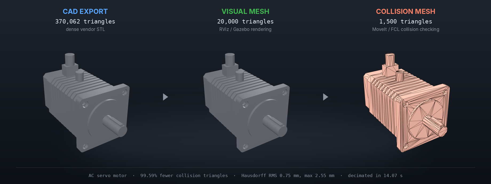
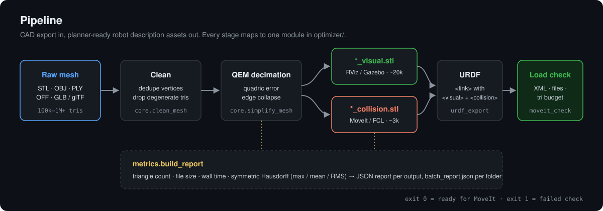
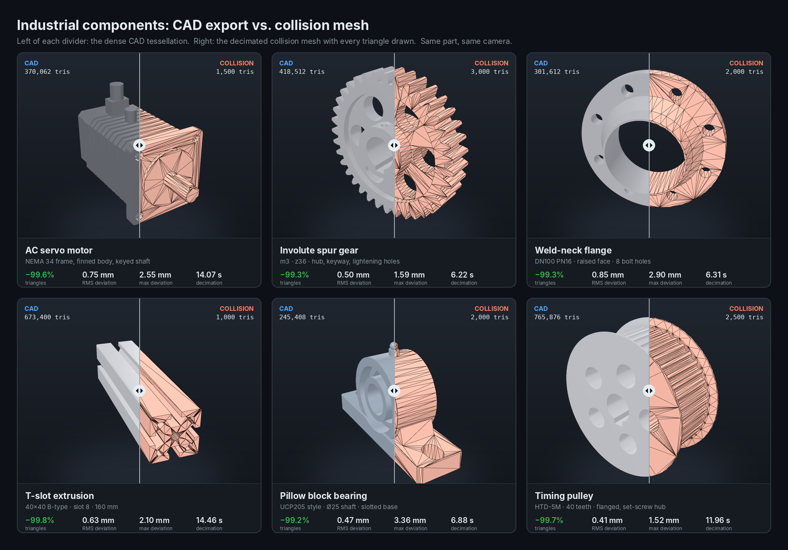
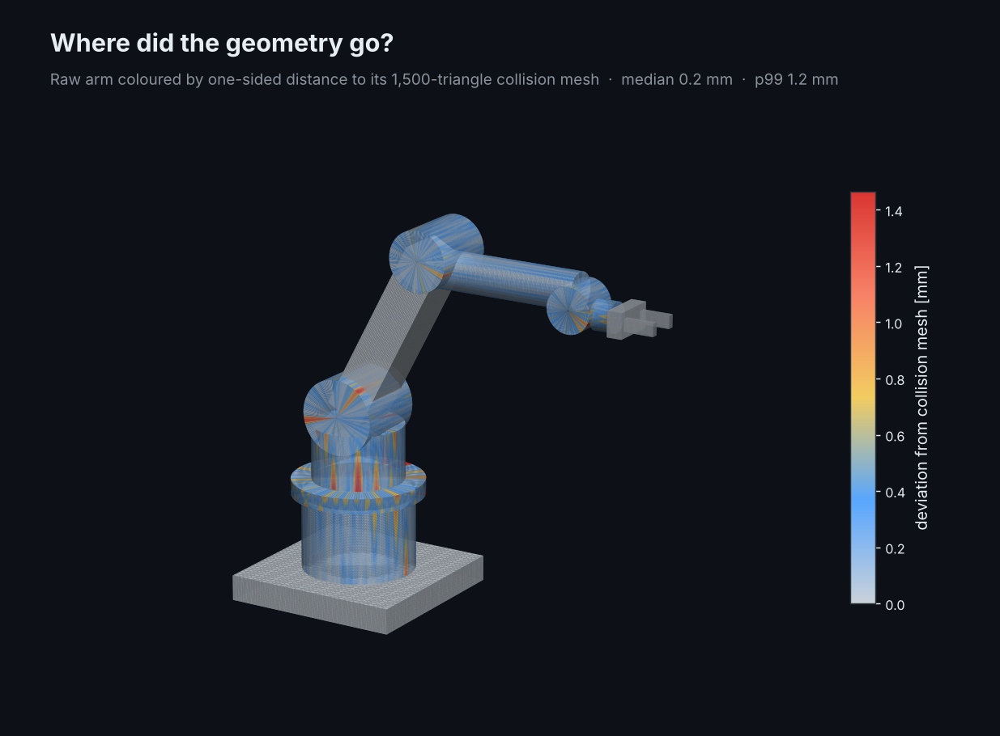
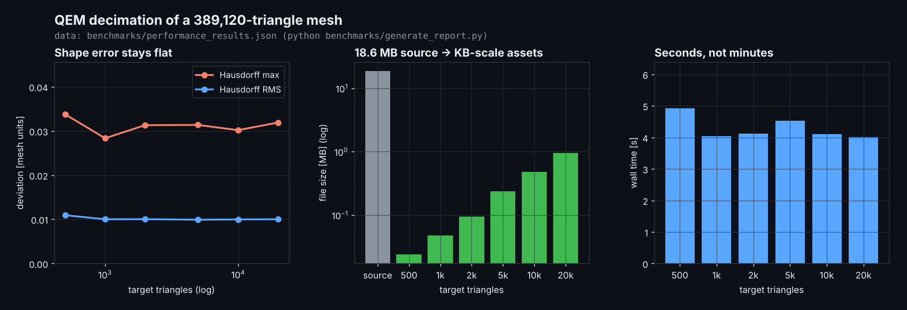

<div align="center">

# ros-mesh-preprocessor

**Turn heavy CAD exports into real-time-ready visual and collision meshes for ROS 2, MoveIt and Gazebo.**

[](https://github.com/ookkshirsagar/ros-mesh-preprocessor/actions/workflows/ci.yml)
[](pyproject.toml)
[](https://docs.ros.org/)
[](LICENSE)



</div>

A 200,000-triangle CAD export dropped straight into MoveIt or Gazebo slows planning to a crawl. This command-line tool turns raw meshes into clean, lightweight visual and collision meshes, and tells you exactly how much shape was lost.

## Highlights

- **Whole robot in one command.** Point it at a URDF and every mesh gets optimized, with the URDF rewritten to match.
- **Measured, not eyeballed.** Every output comes with a Hausdorff deviation report.
- **Ready for CI.** A MoveIt load check fails the build when a mesh is missing, empty or over budget.
- **No ROS install needed.** Outputs drop straight into any `*_description` package.

<p align="center">
  
</p>

## Quick start

```bash
git clone https://github.com/ookkshirsagar/ros-mesh-preprocessor.git
cd ros-mesh-preprocessor
pip install -e .
```

```bash
# A whole robot: every collision mesh in the URDF, URDF rewritten to match
ros-mesh-preprocessor --urdf my_robot.urdf --output ./optimized --collision 2000

# One mesh
ros-mesh-preprocessor --input part.stl --output part_small.stl --triangles 5000
```

Requires Python 3.10 to 3.12. Open3D has no Python 3.13 wheels yet; use a 3.12 virtual environment or the [Docker image](#docker).

## Results on industrial parts

Six parametric components built from catalogue dimensions (bores, keyways, bolt circles, involute teeth, T-slots), exported as densely as a CAD "fine" STL, then run through the same code path as the CLI. Left of each divider is the CAD model; right is the collision mesh with every triangle drawn.

<p align="center">
  
</p>

| Component | CAD triangles | Collision triangles | Reduction | Deviation (RMS) | Deviation (max) |
|---|---:|---:|---:|---:|---:|
| AC servo motor | 370,062 | 1,500 | 99.59% | 0.75 mm | 2.55 mm |
| Involute spur gear | 418,512 | 3,000 | 99.28% | 0.50 mm | 1.59 mm |
| Weld-neck flange | 301,612 | 2,000 | 99.34% | 0.85 mm | 2.90 mm |
| T-slot extrusion | 673,400 | 1,000 | 99.85% | 0.63 mm | 2.10 mm |
| Pillow block bearing | 245,408 | 2,000 | 99.19% | 0.47 mm | 3.36 mm |
| Timing pulley | 765,876 | 2,500 | 99.67% | 0.41 mm | 1.52 mm |

### Where the geometry went

Each CAD surface below is coloured by its distance to its collision mesh. Flat faces come through untouched; the small error that remains sits on curved surfaces such as the flange bore and the bearing housing.

<p align="center">
  
</p>

<details>
<summary>How these figures are made</summary>

<br>

Part geometry is in [`docs/figures/parts.py`](docs/figures/parts.py) and every number shown is in [`docs/figures/results.json`](docs/figures/results.json). Deviation is the Hausdorff distance, estimated from 50,000 sample points per surface, so values vary slightly between runs. The heatmap measures one direction (CAD to collision); the table's maximum also measures the reverse, which catches collision triangles that cut across concave features.

To regenerate everything (about 3 minutes, no GPU needed):

```bash
pip install -e ".[viz]"
sudo apt install libegl1 libgl1-mesa-dri
python docs/generate_figures.py
```

</details>

## Usage

### Whole robot

```bash
ros-mesh-preprocessor \
  --urdf my_robot_description/urdf/my_robot.urdf \
  --output ./my_robot_optimized \
  --collision 2000 \
  --mesh-uri-prefix package://my_robot_description/meshes_optimized
```

This writes a copy of the URDF with updated mesh paths, the new meshes (`meshes/collision/`, plus `meshes/visual/` if you pass `--visual N`), and a `urdf_report.json` with per-mesh triangle counts and deviation.

Only mesh references change. Joints, inertials, materials, primitive shapes and `ros2_control` / `gazebo` tags are copied as they are.

<details>
<summary>Details: package lookup, visual meshes, xacro, dry run</summary>

<br>

- **Package lookup.** `package://` names are found next to the URDF, in a sourced ROS 2 workspace (`AMENT_PREFIX_PATH`), or with `--package-path NAME=DIR`.
- **Visual meshes** are left alone unless you pass `--visual N`, because they usually carry colours and materials.
- **Shared meshes** are processed once. Meshes already under budget are copied without decimation.
- **Unsupported formats** such as COLLADA `.dae` keep their original path and are listed as skipped.
- **xacro files** must be expanded first: `xacro robot.urdf.xacro > robot.urdf`.
- **`--dry-run`** prints the plan without writing anything.

</details>

**Tested on a real robot.** Using the Universal Robots UR5e's visual geometry as collision meshes (the way many CAD-exported robots ship), all seven links were processed in under 2 seconds:

| Link mesh | Before | After | Deviation (RMS) |
|---|---:|---:|---:|
| base | 4,838 | 1,499 | 1.5 mm |
| shoulder | 23,290 | 1,500 | 1.6 mm |
| upper arm | 40,124 | 1,500 | 2.7 mm |
| forearm | 15,058 | 1,500 | 2.1 mm |
| wrist 1 | 17,288 | 1,500 | 1.1 mm |
| wrist 2 | 20,280 | 1,499 | 1.1 mm |
| wrist 3 | 911 | 911 (already under budget) | 0 mm |
| **Total** | **121,789** | **9,909** | |

<sub>Meshes from [Universal_Robots_ROS2_Description](https://github.com/UniversalRobots/Universal_Robots_ROS2_Description) (BSD-3-Clause), converted from `.dae` to STL. For scale, Universal Robots' hand-made collision meshes for this arm total 7,558 triangles.</sub>

### Single mesh

```bash
# To a fixed triangle count
ros-mesh-preprocessor --input model.stl --output model_small.obj --triangles 5000

# By percentage (keep 20%)
ros-mesh-preprocessor --input env.ply --output env_small.ply --reduction 80
```

### Visual and collision pair from one mesh

```bash
ros-mesh-preprocessor --input robot_cell.stl --urdf-output ./output --visual 20000 --collision 3000
```

This produces `robot_cell_visual.stl`, `robot_cell_collision.stl`, JSON reports, and a `<link>` snippet ready to paste into your URDF.

### A folder of meshes

```bash
ros-mesh-preprocessor --folder ./cell_assets --output ./optimized --collision 5000 --save-report
```

<details>
<summary>More options</summary>

<br>

| Flag | Effect |
|---|---|
| `--save-report` | Write a JSON report next to each output |
| `--dry-run` | Show what would happen without writing files |
| `--format obj` | Force the output format regardless of file extension |
| `--skip-hausdorff` | Skip the deviation measurement (faster on huge meshes) |
| `-v` | Verbose logging |

Run `ros-mesh-preprocessor --help` for the full reference. Exit codes: `0` success, `1` a reported error, `2` invalid arguments.

Supported formats for reading and writing: STL, OBJ, PLY, OFF, GLB and glTF. Changing the output extension converts the format.

</details>

### Docker

```bash
docker build -t ros-mesh-preprocessor .
docker run --rm -v "$PWD:/work" ros-mesh-preprocessor --urdf robot.urdf --output out --collision 2000
```

## Validation and benchmarks

**MoveIt load check.** `python examples/moveit_cell_demo/run_demo.py` runs the full pipeline and finishes with a static check: the URDF is valid XML, every mesh file exists and loads, and the collision mesh is within budget. It exits `0` on success and `1` otherwise, so it works as a CI gate.

**Speed and quality.** Decimating a 389,120-triangle mesh to targets between 500 and 20,000 triangles takes about 4 seconds each, and the deviation stays flat across the whole range:



<details>
<summary>Benchmark table and report format</summary>

<br>

| Target triangles | Reduction | File size | Time | Deviation (max) | Deviation (RMS) |
|---:|---:|---:|---:|---:|---:|
| 20,000 | 94.86% | 18.6 MB to 0.95 MB | 4.01 s | 0.0319 | 0.0100 |
| 10,000 | 97.43% | 18.6 MB to 0.48 MB | 4.11 s | 0.0302 | 0.0100 |
| 5,000 | 98.72% | 18.6 MB to 0.24 MB | 4.53 s | 0.0314 | 0.0099 |
| 2,000 | 99.49% | 18.6 MB to 0.10 MB | 4.12 s | 0.0313 | 0.0100 |
| 1,000 | 99.74% | 18.6 MB to 0.05 MB | 4.05 s | 0.0284 | 0.0100 |
| 500 | 99.87% | 18.6 MB to 0.02 MB | 4.92 s | 0.0338 | 0.0109 |

Deviations are in mesh units. Reproduce with `python benchmarks/generate_report.py`; raw output is in [`benchmarks/performance_results.json`](benchmarks/performance_results.json).

Each run's `--save-report` JSON looks like this:

```json
{
  "input_file": "robot_cell.stl",
  "output_file": "output/robot_cell_collision.stl",
  "original_triangles": 389120,
  "reduced_triangles": 3000,
  "reduction_percent": 99.23,
  "file_size_before_mb": 18.555,
  "file_size_after_mb": 0.143,
  "processing_time_sec": 3.65,
  "hausdorff_max": 0.032679,
  "hausdorff_mean": 0.008853,
  "hausdorff_rms": 0.009990
}
```

</details>

## Why not MeshLab or Blender?

They're excellent for one-off manual cleanup. This tool is for the repeatable case: the same settings across a whole robot, every time, scriptable and runnable in CI, with a number for how much each mesh changed.

## Roadmap

- [x] Whole-robot URDF mode
- [x] Docker image and automated PyPI releases
- [ ] COLLADA (`.dae`) input
- [ ] Convex decomposition for collision meshes (CoACD / V-HACD)
- [ ] MuJoCo (MJCF) and Gazebo (SDF) export
- [ ] MoveIt planning-time benchmark, before and after

## Contributing

Pull requests are welcome; for larger changes, please open an issue first. See [CONTRIBUTING.md](CONTRIBUTING.md) for setup and [CHANGELOG.md](CHANGELOG.md) for release history.

```bash
pip install -e ".[dev]"
pre-commit install
pytest tests/
```

<details>
<summary>Project layout</summary>

<br>

```
optimizer/            the package
  core.py               load, clean, simplify, save
  metrics.py            Hausdorff deviation and JSON reports
  urdf_robot.py         whole-robot URDF mode
  urdf_export.py        visual and collision pair with URDF snippet
  moveit_check.py       static MoveIt load check
  cli.py                command-line interface
examples/             end-to-end MoveIt demo
benchmarks/           benchmark script and results
docs/                 figure generator, part models, images
tests/                72 tests
.github/              CI, release workflow, issue templates, Dependabot
```

</details>

## Citation and license

If this tool helps your research or product, please cite it using [`CITATION.cff`](CITATION.cff) (GitHub's "Cite this repository" button). Released under the [MIT License](LICENSE). Built on [Open3D](https://www.open3d.org/).
